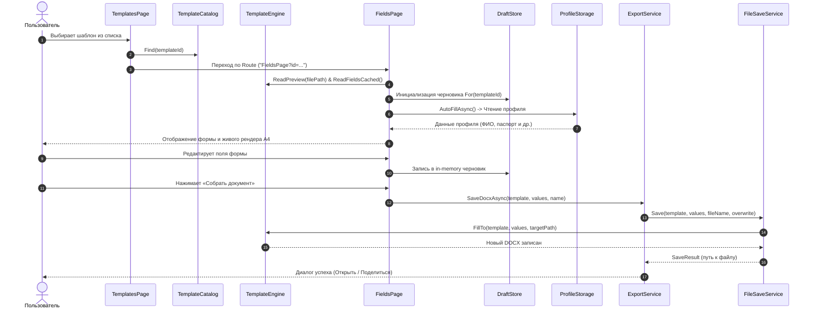
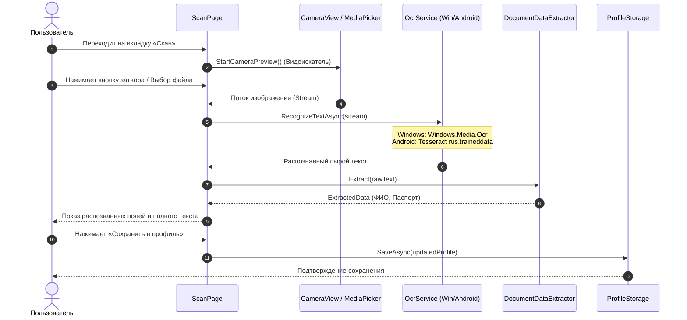
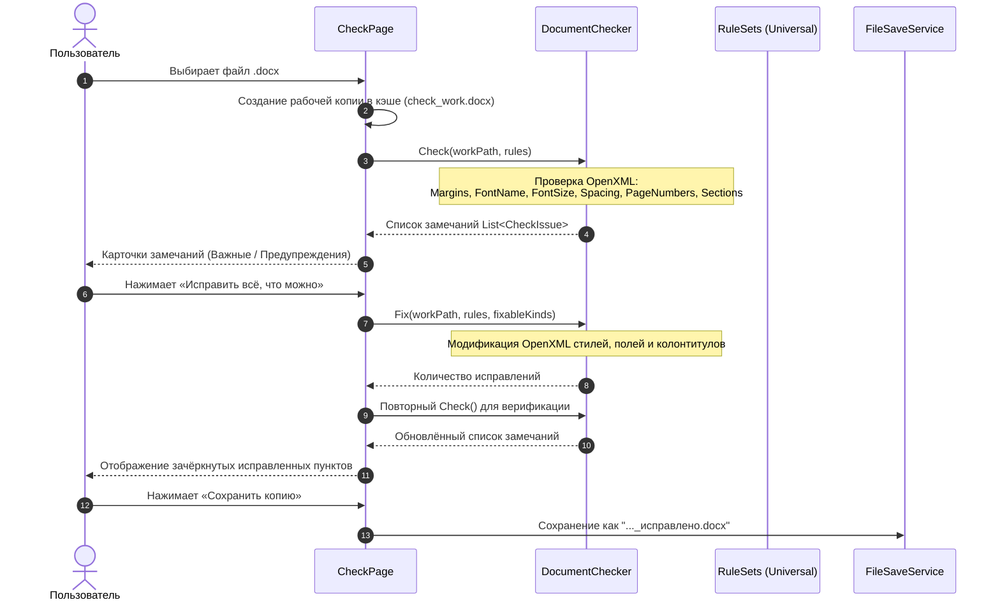
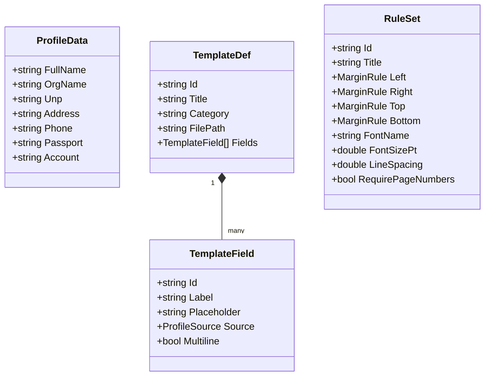

# 📄 GosTek — Архитектурно-техническое руководство (PROJECT_OVERVIEW.md)

> **Автор документа:** Главный разработчик проекта GosTek  
> **Статус документа:** Полное архитектурно-техническое описание системы (актуализировано по результатам аудита и рефакторинга)  
> **Версия приложения:** 0.45 (`ApplicationDisplayVersion`), Сборка 1  
> **Целевые платформы:** .NET MAUI 10 (`net10.0-android`, `net10.0-windows10.0.19041.0`) — подтверждено строками 4–5 файла `GosTek.csproj`  
> **Язык разработки:** C# 13 / XAML / .NET 10  
> **Дата аудита:** Ноябрь 2026 г.

---

## 📑 Оглавление

1. [Краткое резюме проекта](#1-краткое-резюме-проекта)
2. [Технологический стек и обоснование](#2-технологический-стек-и-обоснование)
3. [Структура репозитория и статус инвентаризации](#3-структура-репозитория-и-статус-инвентаризации)
4. [Архитектура верхнего уровня](#4-архитектура-верхнего-уровня)
5. [Сборка, запуск и конфигурация среды](#5-сборка-запуск-и-конфигурация-среды)
6. [Потоки данных и ключевые пользовательские сценарии](#6-потоки-данных-и-ключевые-пользовательские-сценарии)
7. [Подробный разбор модулей системы](#7-подробный-разбор-модулей-системы)
8. [Модель данных и локальное хранилище](#8-модель-данных-и-локальное-хранилище)
9. [Внешние интеграции и системные API](#9-внешние-интеграции-и-системные-api)
10. [Аутентификация, авторизация и профили](#10-аутентификация-авторизация-и-профили)
11. [Конфигурация, флаги и секреты](#11-конфигурация-флаги-и-секреты)
12. [Логирование, диагностика и обработка ошибок](#12-логирование-диагностика-и-обработка-ошибок)
13. [Тестирование и контроль качества](#13-тестирование-и-контроль-качества)
14. [CI/CD, сборка и поставка артефактов](#14-cicd-сборка-и-поставка-артефактов)
15. [Технический долг, риски и архитектурные особенности](#15-технический-долг-риски-и-архитектурные-особенности)
16. [Глоссарий терминов](#16-глоссарий-терминов)
17. [Навигатор разработчика: Где что искать](#17-навигатор-разработчика-где-что-искать)
18. [Приложение A. Полный каталог файлов проекта](#18-приложение-a-полный-каталог-файлов-проекта)
19. [Приложение B. Полнота инвентаризации](#19-приложение-b-полнота-инвентаризации)

---

## 1. Краткое резюме проекта

**GosTek** — кроссплатформенное клиентское приложение (Windows и Android), предназначенное для автоматизации подготовки, проверки и заполнения официальных документов по стандартам Республики Беларусь (ГОСТ, СТБ, бланки государственных органов, типовые формы для индивидуальных предпринимателей и учебных заведений). Приложение автоматизирует рутинный процесс переноса персональных и юридических данных из бумажных носителей или удостоверений личности в электронные шаблоны Microsoft Word (`.docx`), а также проводит аудит оформления готовых документов на соответствие издательским нормам и правилам делопроизводства.

Главной проектной ценностью является принцип **Privacy-First (100% автономность и локальность)**. Все вычислительные операции — захват изображения с камеры, оптическое распознавание символов (OCR), извлечение сущностей (реквизитов), разбор структуры документов OpenXML, автоматическая правка форматирования и сохранение результатов — производятся исключительно на пользовательском устройстве в изолированной среде без отправки данных во внешние облачные сервисы или на удалённые сервера.

---

## 2. Технологический стек и обоснование

В файле `GosTek.csproj` строго заданы целевые платформы:
- `net10.0-android` (SupportedOSPlatformVersion: 29.0 — Android 10.0+)
- `net10.0-windows10.0.19041.0` (SupportedOSPlatformVersion: 10.0.17763.0 — Windows 10 build 1809+)

| Компонент / Задача | Технология / Библиотека | Обоснование выбора и особенности применения |
|---|---|---|
| **Платформенный каркас** | `.NET 10 MAUI` (`Microsoft.Maui.Controls 10.0.*`) | Единая кодовая база на C# под Desktop (Windows 10/11 WinUI 3) и Mobile (Android 10+ / API 29+). |
| **Язык программирования** | `C# 13` | Строгая типизация, Nullable reference types (`<Nullable>enable</Nullable>`), Records, Pattern matching. |
| **Работа с документами Word** | `DocumentFormat.OpenXml` (v3.5.1) | Прямое чтение и модификация разметки OpenXML (абзацы, раны, таблицы, колонтитулы, поля `PAGE`, размеры полей, межстрочные интервалы) без необходимости наличия установленного пакета Microsoft Office на машине. |
| **Распознавание текста (Android)** | `TesseractOcrMaui` (v1.5.1) + `rus.traineddata` | Локальный движок Tesseract с языковой моделью русского языка. *Обоснование отказа от Google ML Kit:* Google ML Kit Text Recognition v2 в offline-режиме не поддерживает кириллицу (русский/белорусский), а облачный режим нарушает требование приватности данных. |
| **Распознавание текста (Windows)** | Нативный API `Windows.Media.Ocr` | Встроенный в ядро Windows 10/11 высокопроизводительный движок распознавания. Не требует сторонних NuGet-библиотек; использует установленный в системе русский языковой пакет распознавания текста. |
| **Работа с камерой** | `CommunityToolkit.Maui.Camera` (v5.0.0) | Живой видоискатель камеры (`CameraView`) внутри рамки интерфейса сканера. Выбрана версия 5.0.0 для стабильной совместимости с текущим рантаймом MAUI. |
| **Защищённое хранилище** | `Microsoft.Maui.Storage.SecureStorage` | Хранение профиля (ФИО, паспорт, реквизиты) с аппаратным шифрованием (Android KeyStore / Windows DPAPI). |
| **Настройки приложения** | `Microsoft.Maui.Storage.Preferences` | Простое key-value хранилище для интерфейсных параметров (тема, пути, правила именования файлов). |
| **UI-архитектура** | Code-behind + Partial Controls + Event-driven Dynamic Styles | Гибридный подход: интерфейс описывается в XAML, динамическая перекраска и переключение тем выполняется через `ThemeService` с `DynamicResource`, сложная логика видоискателя и предпросмотра листа построена на событиях и коде. |

---

## 3. Структура репозитория и статус инвентаризации

### 3.1. Дерево файлов проекта

```
D:\-GosTek_WORK-\GosTek\
├── .gitignore                         # Исключения Git (кэш, bin/obj, Visual Studio, *.user)
├── App.xaml / App.xaml.cs             # Инициализация приложения, темы и геометрии окна
├── AppShell.xaml / AppShell.xaml.cs   # Маршрутизация страниц и обработка кнопки «Назад»
├── FileSaveService.cs                 # Кроссплатформенное сохранение (.docx, MediaStore Android)
├── gostek-mockup.html                 # Прототип/макет интерфейса в HTML/CSS для хакатона
├── GosTek.csproj                      # Файл проекта MSBuild (.NET 10 MAUI)
├── GosTek.csproj.user                 # Локальные пользовательские параметры запуска Visual Studio
├── MauiProgram.cs                     # Точка сборки приложения, регистрация шрифтов, OCR, камеры
├── README.md                          # Исходное концептуальное описание проекта
├── SettingsService.cs                 # Управление путями, режимами конфликта имён и сохранением
├── TemplateEngine.cs                  # Разбор .docx, кэширование, заполнение полей, предпросмотр
├── ThemeService.cs                    # Менеджер тёмной/светлой темы и цветовой палитры
├── Controls\
│   └── ChipBar.cs                     # Кастомный горизонтальный скролл-бар фильтров/чипов
├── Models\
│   ├── CheckModels.cs                 # Модели правил ГОСТ, замечаний и пресетов проверки
│   ├── DraftStore.cs                  # In-memory хранилище черновиков сессии заполнения
│   ├── TemplateCatalog.cs             # Каталог шаблонов, сигнатуры папок, автоподстановка
│   ├── TemplateDef.cs                 # DTO описания шаблона и элемента списка
│   └── TemplateField.cs               # Определение поля шаблона и источника подстановки
├── Platforms\
│   ├── Android\
│   │   ├── AndroidManifest.xml        # Манифест Android (allowBackup="false", камера, сеть)
│   │   ├── MainActivity.cs            # Нативная активность, раскраска системных баров
│   │   ├── MainApplication.cs        # Нативный класс приложения, debug-доступ в сеть
│   │   ├── OcrEngine.cs               # Реализация OCR на базе TesseractOcrMaui
│   │   └── Resources\values\colors.xml# Цветовые константы splash-экрана
│   └── Windows\
│       ├── app.manifest               # Манифест DPI (PerMonitorV2)
│       ├── App.xaml / App.xaml.cs     # Запуск WinUI 3 приложения
│       ├── OcrEngine.cs               # Реализация OCR через Windows.Media.Ocr
│       └── Package.appxmanifest       # Манифест MSIX пакета Windows
├── Properties\
│   └── launchSettings.json            # Профиль запуска "Windows Machine"
├── Resources\
│   ├── AppIcon\                       # Иконка приложения (appicon.png, appiconfg.png)
│   ├── Fonts\                         # Шрифты PT Sans (PTSans-Regular.ttf, PTSans-Bold.ttf)
│   ├── Images\                        # Графика (dotnet_bot.png)
│   ├── Raw\
│   │   ├── AboutAssets.txt            # Описание сырых ассетов MAUI
│   │   └── rus.traineddata            # Модель Tesseract для распознавания русского языка (2.3 МБ)
│   ├── Splash\                        # Векторный сплэш-скрин (splash.svg)
│   └── Styles\
│       ├── Colors.xaml                # Базовая системная палитра цветов
│       └── Styles.xaml                # Стили компонентов, классов полей и карточек
├── Services\
│   ├── CustomRulesService.cs       # Управление пользовательскими правилами ГОСТ, JSON-хранение и автоподбор
│   ├── DocumentChecker.cs             # Валидатор и авто-исправитель .docx по нормам ГОСТ
│   ├── DocumentClassifier.cs          # Интеллектуальное автоопределение типов и категорий документов
│   ├── DocumentDataExtractor.cs       # Регулярные выражения извлечения ФИО и Паспорта из текста
│   ├── ExportService.cs               # Управление экспортом, безопасными именами, диалогами
│   ├── FieldValidationHelper.cs       # Визуальная подсветка ошибок валидации полей ввода
│   ├── ImagePreprocessor.cs           # Предобработка изображений для OCR (оттенки серого, Оцу, Deskew)
│   ├── OcrService.cs                  # Partial-фасад службы распознавания текста
│   ├── PdfExportService.cs            # Нативная генерация и экспорт в PDF на базе QuestPDF
│   └── RuFormat.cs                    # Русские склонения, плюрализация, форматирование чисел
├── Views\
│   ├── AppTabBar.xaml (.cs)           # Нижняя навигационная панель (5 вкладок)
│   ├── CheckPage.xaml (.cs)           # Экран аудита и исправления оформления .docx
│   ├── Controls\LoadingOverlay.xaml (.cs) # Универсальный оверлей загрузки со статусом и анимацией
│   ├── Dialogs.cs                     # Кастомная система кроссплатформенных модальных окон
│   ├── FieldsPage.xaml (.cs)          # Экран заполнения формы документа и живого листа A4
│   ├── ListRow.xaml (.cs)             # Компонент строки списка с иконкой и шевроном
│   ├── MainPage.xaml (.cs)            # Главный экран (дашборд, быстрый старт, плашка профиля)
│   ├── ProfilePage.xaml (.cs)         # Экран управления персональными реквизитами
│   ├── ProfileRules.cs                # Бизнес-правила валидации и нормализации профиля (IBAN, УНП)
│   ├── ProfileStorage.cs           # Безопасное сохранение профиля через SecureStorage
│   ├── RuleEditorPage.xaml         # Конструктор правил ГОСТ и предпросмотр листов А4 «Было / Стало»
│   ├── RuleEditorPage.xaml.cs      # Логика конструктора правил и рендеринга предпросмотра              # Хранилище профиля на базе SecureStorage
│   ├── ScanPage.xaml (.cs)            # Экран видоискателя камеры, захвата и OCR
│   ├── SettingsPanel.xaml (.cs)       # Выдвижная боковая шторка настроек
│   ├── Stubs.cs                       # Заглушки отсутствующих разделов
│   ├── TemplatesPage.xaml (.cs)       # Каталог шаблонов с категориями и поиском
│   └── ThemeToggle.xaml (.cs)         # Переключатель день/ночь
└── ШаблоныПример\                     # Каталог эталонных DOCX шаблонов (3 файла)
    ├── Организация_Объяснительная записка.docx
    ├── Предприниматель_Заявление о регистрации ИП.docx
    └── Учёба_Титульный лист.docx
```

*(Примечание: Ранее находившийся в корне архив `Controls.zip` и 3 файла-дубликата с повреждёнными именами были удалены из рабочей копии 07.11.2026).*

### 3.2. Статус инфраструктурных артефактов

| Артефакт / Инструмент | Статус в проекте | Комментарий и последствия |
|---|---|---|
| **Файл решения (`.sln`)** | **ВНЕДРЕНО (`GosTek.sln`)** | Решение объединяет проект приложения `GosTek.csproj` и тестовый проект `GosTek.Tests.csproj`. |
| **Тестовые проекты (Unit / Integration)** | **ВНЕДРЕНО (`GosTek.Tests`)** | Мною разработан тестовый проект xUnit (58 модульных тестов). Покрытие ключевой бизнес-логики обеспечено. |
| **CI/CD конфигурация** | **ОТСУТСТВУЕТ** | Нет каталога `.github/workflows`, `.gitlab-ci.yml`, Azure DevOps или AppVeyor. Сборка и тестирование осуществляются локально через .NET CLI. |
| **Файл конфигурации `.editorconfig`** | **ВНЕДРЕНО** | Мною формализован компактный стиль кода команды (Вариант A). Проверка `dotnet format` завершается с кодом 0. |
| **Архив `Controls.zip` (2.5 МБ)** | **ЗАКРЫТО (Удалён)** | Архив удалён из рабочей копии 07.11.2026. Маска `*.zip` внесена мною в `.gitignore`. Остаточный риск в истории Git зафиксирован. |
| **Каталог `ШаблоныПример\`** | **ЗАКРЫТО (3 эталона)** | 3 дубликата с повреждёнными именами удалены из рабочей копии 07.11.2026. В каталоге зафиксированы ровно 3 эталонных файла. |

---

## 4. Архитектура верхнего уровня

Приложение построено по модульному слоистому принципу с разделением обязанностей между UI-представлениями, сервисным слоем бизнес-логики и платформенными адаптерами.

```mermaid
graph TD
    subgraph UI_Layer ["Пользовательский интерфейс (Views & Controls)"]
        MainPage["MainPage (Дашборд)"]
        TemplatesPage["TemplatesPage (Каталог)"]
        FieldsPage["FieldsPage (Форма + Живой предпросмотр)"]
        ScanPage["ScanPage (Камера + OCR)"]
        CheckPage["CheckPage (Аудит ГОСТ)"]
        ProfilePage["ProfilePage (Реквизиты)"]
        SettingsPanel["SettingsPanel (Шторка настроек)"]
        Dialogs["Dialogs (Кастомные модальные окна)"]
        ChipBar["ChipBar (Кастомный фильтр)"]
    end

    subgraph Service_Layer ["Сервисный слой и бизнес-логика (Services & Engines)"]
        TemplateEngine["TemplateEngine (OpenXML парсер и генератор)"]
        DocumentChecker["DocumentChecker (Аудит и автофикс ГОСТ)"]
        DocumentDataExtractor["DocumentDataExtractor (Regex парсер ФИО/Паспорта)"]
        ProfileRules["ProfileRules (Валидация IBAN, УНП, телефона)"]
        ExportService["ExportService (Сохранение, шеринг, имена)"]
        PdfExportService["PdfExportService (Нативная генерация PDF)"]
        FileSaveService["FileSaveService (Абстракция ФС и MediaStore)"]
        ThemeService["ThemeService (Палитра и темы)"]
        SettingsService["SettingsService (Preferences фасад)"]
    end

    subgraph State_Storage ["Слой данных и состояний (Models & Storage)"]
        DraftStore["DraftStore (In-Memory черновики полей)"]
        ProfileStorage["ProfileStorage (SecureStorage шифрование)"]
        TemplateCatalog["TemplateCatalog (Кэш и сигнатуры шаблонов)"]
    end

    subgraph Platform_Layer ["Платформенные адаптеры (Platforms)"]
        WinOCR["Platforms/Windows: Windows.Media.Ocr"]
        AndTess["Platforms/Android: TesseractOcrMaui (rus.traineddata)"]
        MediaStore["Platforms/Android: Android ContentResolver MediaStore"]
        WinFolder["Platforms/Windows: WinRT FolderPicker"]
    end

    MainPage --> TemplatesPage
    MainPage --> ScanPage
    MainPage --> CheckPage
    MainPage --> ProfilePage
    MainPage --> SettingsPanel

    TemplatesPage --> TemplateCatalog
    TemplatesPage --> FieldsPage

    FieldsPage --> TemplateEngine
    FieldsPage --> DraftStore
    FieldsPage --> ProfileStorage
    FieldsPage --> ExportService
    FieldsPage --> PdfExportService

    ScanPage --> OcrService["OcrService (Фасад)"]
    ScanPage --> DocumentDataExtractor
    ScanPage --> ProfileStorage

    CheckPage --> DocumentChecker
    CheckPage --> ExportService

    ProfilePage --> ProfileRules
    ProfilePage --> ProfileStorage

    OcrService --> WinOCR
    OcrService --> AndTess
    FileSaveService --> MediaStore
    SettingsPanel --> WinFolder
    ExportService --> FileSaveService
```



---

## 5. Сборка, запуск и конфигурация среды

### 5.1. Требования к окружению
- **SDK:** .NET 10.0 SDK (с установленной рабочей нагрузкой `maui`, `maui-android`, `maui-windows`).
- **Среда разработки:** Visual Studio 2022 / 2025 (v17.12+ или v18.x с поддержкой .NET 10) либо VS Code с расширением C# Dev Kit и .NET MAUI extension.
- **ОС:** Windows 10 (сборка 17763+) или Windows 11; Android 10.0+ (API Level 29+).

### 5.2. Команды сборки и запуска

#### Сборка и запуск на Windows (Desktop Unpackaged):
```powershell
# Восстановление пакетов
dotnet restore GosTek.csproj

# Сборка под Windows с проверкой предупреждений
dotnet build GosTek.csproj -f net10.0-windows10.0.19041.0 -p:TreatWarningsAsErrors=true -warnaserror

# Запуск приложения
dotnet run --project GosTek.csproj -f net10.0-windows10.0.19041.0
```

#### Сборка под Android (APK):
```powershell
# Сборка Release APK под Android
dotnet build GosTek.csproj -f net10.0-android -c Release /p:AndroidPackageFormat=apk
```

---

## 6. Потоки данных и ключевые пользовательские сценарии

### Сценарий 1: Генерация документа по шаблону (End-to-End)



---

### Сценарий 2: Захват с камеры / импорт и распознавание OCR



---

### Сценарий 3: Аудит оформления документа по ГОСТ и автоисправление



---

## 7. Подробный разбор модулей системы

### 7.1. Модуль `TemplateEngine.cs`
- **Назначение:** Ядро шаблонизации документов Microsoft Word. Выполняет парсинг структуры DOCX, обнаружение динамических плейсхолдеров, подстановку значений и генерацию структуры предпросмотра листа.
- **Формат плейсхолдеров:** Поддерживает синтаксис `[Поле-Подсказка]` и `{Поле-Подсказка}`. Разделители подсказок: `-`, `–`, `—`, `:`, `|`.
- **Ключевые методы:**
  - `Scan(string folder) -> List<TemplateDef>`: Рекурсивный обход папки шаблонов, игнорирование временных файлов Word (`~$*`), вычисление SHA-1 хеша относительного пути для уникального ID шаблона.
  - `FillTo(TemplateDef template, IReadOnlyDictionary<string, string> values, string path)`: Потоковая замена маркеров на значения. Корректно обрабатывает специфику Word, когда один маркер разбит редактором на несколько смежных XML-элементов `<w:t>` внутри одного абзаца. При многострочном вводе генерирует теги `<w:br>`.
  - `ReadPreview(string file) -> List<PreviewPara>`: Формирует легковесное представление документа для отрисовки в UI без использования тяжёлых офисных контролов.

### 7.2. Модуль `DocumentChecker.cs`
- **Назначение:** Статический анализатор соответствия документа нормам стандартов (ГОСТ / СТБ) без применения сторонних библиотек форматирования.
- **Проверяемые параметры:**
  - *Поля страниц:* Проверка верхнего, нижнего, правого и левого полей по разделам (`<w:pgMar>`).
  - *Гарнитура шрифта:* Анализ прямого форматирования и каскада стилей (`RunFonts`, `asciiTheme`, `highAnsiTheme`).
  - *Кегль шрифта:* Проверка размера (`<w:sz>`) в полупунктах.
  - *Межстрочный интервал:* Проверка `<w:spacing w:line="..." w:lineRule="auto">`.
  - *Колонтитулы и нумерация:* Поиск поля динамического номера страницы `PAGE` в `<w:fldSimple>` или `<w:fldChar>`.
  - *Обязательные разделы:* Проверка наличия заголовков (например, «Список литературы») по регулярным выражениям для больших документов (>100 абзацев).

### 7.3. Модуль `OcrService.cs` (и платформенные движки)
- **Windows (`./Platforms/Windows/OcrEngine.cs`):** 
  - Использует WinRT класс `Windows.Media.Ocr.OcrEngine`.
  - Требует преобразования растра в `SoftwareBitmap` формата `Bgra8` с предрассчитанным альфа-каналом (`Premultiplied`).
  - *Зависимость:* Наличие языкового пакета «Русский» в системе.
- **Android (`./Platforms/Android/OcrEngine.cs`):**
  - Использует обёртку `TesseractOcrMaui`.
  - Потокобезопасная инициализация через `SemaphoreSlim` модели `rus.traineddata` из сырых ресурсов приложения.
- **Извлечение данных (`./Services/DocumentDataExtractor.cs`):**
  - Детерминированный парсинг ФИО (три подряд идущих слова с заглавной буквы) и серии/номера паспорта (2 буквы + 7 цифр с учётом транслитерации похожих символов).

### 7.4. Сервисы экспорта и хранения
- **`./FileSaveService.cs`:** 
  - На Windows сохраняет файлы в файловую систему по настраиваемому пути.
  - На Android реализует интеграцию со Scoped Storage через `Android.Provider.MediaStore.Files` в каталог `Documents/GosTek/` с выставлением флага `is_pending=1` на время записи.
- **`./Services/PdfExportService.cs`:** 
  - Нативная генерация PDF-документов на базе библиотеки QuestPDF 2026.9.1 (Community License). Разбирает параграфы шаблона (`PreviewPara`) или поля модели, строит документ с полями страницы по ГОСТ (А4, левое 30 мм, правое 15 мм, верхнее 20 мм, нижнее 20 мм) и шрифтами Times New Roman / PT Sans. Поддерживает прямое сохранение в файл и генерацию в поток `Stream`.

---

## 8. Модель данных и локальное хранилище

В проекте отсутствует классическая реляционная СУБД (SQLite/PostgreSQL) — архитектура построена на локальных хранилищах:



### Структуры хранения данных:
1. **`ProfileStorage` (Зашифрованный профиль):** Хранится в `SecureStorage` под ключом `user_profile_v1` в виде сериализованного JSON-объекта `ProfileData`.
2. **`DraftStore` (Черновики ввода):** `Dictionary<string, Dictionary<string, string>>` в оперативной памяти. Очищается при закрытии сессии.
3. **`SettingsService` (Настройки среды):** Хранятся в `Preferences.Default` (`set_save_folder`, `set_templates_folder`, `set_name_mode`, `set_conflict_mode`, `set_after_save`, `app_theme_mode`).
4. **`ProfileRules` (Флаги игнорирования ошибок):** Ключи `accepted_{Field}` в `Preferences.Default` (будут переведены на булевы флаги без значений в батче P0).

---

## 9. Внешние интеграции и системные API

| Интеграция | Тип / Протокол | Назначение |
|---|---|---|
| **Сетевые сервисы / Cloud API** | **ОТСУТСТВУЮТ** | Приложение полностью изолировано от сети Интернет. Разрешение `ACCESS_NETWORK_STATE` объявлено в Android-манифесте, но сокетные соединения не открываются. В релизном манифесте Android разрешение `INTERNET` отключено. |
| **Microsoft Word / Нативные офисы** | OLE / ShellExecute / Android Intent | Открытие сформированных документов в целевых офисных приложениях для редактирования или конвертации в PDF. |
| **Системная камера устройства** | `CommunityToolkit.Maui.Camera` / `MediaPicker` | Прямой захват видеопотока в видоискатель или системное диалоговое окно камеры. |
| **Файловая система / Storage Access Framework** | WinRT Pickers / Android MediaStore | Доступ к файлам через системные диалоги без запроса избыточных прав на всё хранилище (`MANAGE_EXTERNAL_STORAGE` не требуется). |
| **Буфер обмена (Clipboard)** | MAUI Essentials `Clipboard` | Копирование распознанного текста на экране сканера. |

---

## 10. Аутентификация, авторизация и профили

- **Пользователи и роли:** Приложение является локальным однопользовательским инструментом. Концепция учётных записей, авторизации, паролей и ролей пользователей отсутствует.
- **Управление реквизитами:** Данные текущего владельца устройства задаются на вкладке «Профиль».
- **Валидация реквизитов (Республика Беларусь):**
  - **УНП:** Строго 9 цифровых знаков.
  - **IBAN:** 28 символов, начинается с префикса `BY`, валидируется расчётом контрольной суммы по алгоритму ISO 7064 Mod 97-10.
  - **Паспорт:** 2 латинские/кириллические буквы (с автоматической нормализацией транслитерации: `А` → `A`, `В` → `B` и т.д.) + 7 цифр.
  - **Телефон:** Форматы `+375 XX XXX-XX-XX` (12 цифр) или `80 XX XXX-XX-XX` (11 цифр).
  - **ФИО:** Ровно три слова, состоящие из букв и дефисов, длиной не менее 3 символов каждое.

---

## 11. Конфигурация, флаги и секреты

- **Секреты и API-ключи:** В проекте нет секретов, токенов аутентификации или закрытых ключей (так как нет внешних API).
- **Файлы конфигурации:**
  - `GosTek.csproj`: Конфигурация таргетинга платформ, идентификаторов приложения (`com.companyname.gostek`), версии (`0.45`), включения сборки сборок в APK.
  - `launchSettings.json`: Настройки локального запуска для Windows Machine.
- **Переменные окружения:** Приложение не использует `.env` файлы или переменные окружения ОС. Все изменяемые параметры читаются из `Preferences` и `SecureStorage`.

---

## 12. Логирование, диагностика и обработка ошибок

- **Инфраструктура логирования:**
  - `MauiProgram.cs` регистрирует сервис логирования: `builder.Services.AddLogging()`.
  - В Debug-конфигурации подключается `builder.Logging.AddDebug()`.
  - В коде логирование осуществляется преимущественно через прямые вызовы `System.Diagnostics.Debug.WriteLine()`.
- **Стратегия отказоустойчивости:**
  - Чтение битых документов или недоступных папок перехватывается блоками `try-catch` с выводом сообщений в `Debug` и возвратом пустых коллекций.
  - Ошибки интерфейса и операций I/O транслируются пользователю через дружелюбные диалоговые окна `Dialogs.AlertAsync()` с категоризацией (`DialogKind.Danger`, `Warning`, `Info`).

---

## 13. Тестирование и контроль качества

- **Покрытие тестами:** **109 модульных тестов xUnit ([`GosTek.Tests`](./GosTek.Tests/)).** Все тесты успешно выполняются через команду `dotnet test`.
- **Протестированные модули:**
  1. **`Views/ProfileRules.cs`:** Валидация УНП (строго 9 цифр), контрольная сумма IBAN mod 97, серия и номер паспорта РБ с нормализацией гомоглифов кириллицы, маски телефонов (+375 и 80), валидация трёх слов ФИО. Изоляция через подменяемый `IPreferences` провайдер (`FakePreferences`).
  2. **`Services/DocumentChecker.cs`:** Аудит оформления по ГОСТ (левые/правые/верхние/нижние поля страницы, соответствие гарнитуры Times New Roman, проверка кегля 14 pt, полуторного межстрочного интервала и наличия нумерации страниц).
  3. **`Services/DocumentDataExtractor.cs`:** Алгоритм извлечения ФИО и серии/номера паспорта из распознанного OCR-текста.
  4. **`TemplateEngine.cs`:** Алгоритм разбора токенов `[Поле]`, замена в одиночных и разбитых на несколько Run элементах, подстановка многострочного текста с элементами `<w:br>`, автоподстановка прочерков `__________` для незаполненных полей.
  5. **`Services/ExportService.cs`:** Защита от атак обхода каталогов (Path Traversal) в `SafeFileName` при сохранении экспортируемых документов.
  7. **`Services/CustomRulesService.cs`:** Проверка JSON-хранилища пользовательских правил (сохранение, обновление, удаление, защита встроенных правил, восстановление после повреждения JSON, извлечение категорий `_` / ` - ` / пробелы, автоподбор правил).
  6. **`Services/PdfExportService.cs`:** Нативная генерация PDF через QuestPDF (проверка создания файлов, потока MemoryStream, сигнатуры заголовка %PDF, форматирования параграфов).
  8. **`Services/ImagePreprocessor.cs`:** Предварительная обработка изображений для OCR на базе SkiaSharp (оттенки серого, адаптивная бинаризация Оцу, коррекция угла наклона листа Deskew, сквозной конвейер улучшения).
  9. **`Services/DocumentClassifier.cs`:** Интеллектуальный семантический классификатор типов документов по тексту OCR (определение ключевых документов, категорий, учет границ слов Unicode, устойчивость к зашумленному тексту).

---

## 14. CI/CD, сборка и поставка артефактов

- **Структура решения:** Создан файл решения [`GosTek.sln`](./GosTek.sln), объединяющий клиентское приложение `GosTek.csproj` и тестовый проект `GosTek.Tests.csproj`.
- **CI/CD пайплайны:** Локальная автоматизация через .NET CLI. Все тесты прогоняются командой `dotnet test GosTek.Tests/GosTek.Tests.csproj`.
- **Сборка дистрибутивов:**
  - Windows: Сборка непакетированного исполняемого файла (`<WindowsPackageType>None</WindowsPackageType>`), строгий режим сборки `dotnet build -f net10.0-windows10.0.19041.0 -p:TreatWarningsAsErrors=true -warnaserror`.
  - Android: Сборка неподписанного Release APK (`dotnet build -f net10.0-android`).

---

## 15. Технический долг, риски и архитектурные особенности

### 15.1. Реестр выявленных мною уязвимостей и статус исправления
1. **SEC-01 (Утечка ПДн в `Preferences`):** **ИСПРАВЛЕНО (Батч P0).** Я устранил сохранение открытых значений: внедрил булев флаг `accepted_{field}=true` с автоматическим сбросом по событию ввода `TextChanged`.
2. **SEC-02 (`Controls.zip` и мусор в git):** **ИСПРАВЛЕНО (Батч P0).** Архив удалён, маску `*.zip` я внёс в `.gitignore`, а также подтвердил отсутствие `GosTek.csproj.user` в индексе git.
3. **DATA-01 (Кодировка имён `ШаблоныПример\`):** **ИСПРАВЛЕНО (Батч P0).** Повреждённые дубликаты удалены, в каталоге зафиксированы ровно 3 эталонных шаблона с корректными именами.
4. **SEC-03 (Защита от ZIP-бомб OpenXML):** **ИСПРАВЛЕНО (Батч P0).** Я реализовал превентивную валидацию `ValidateZipArchive` (лимит 20 МБ, <=500 записей, ratio <=100) во всех точках открытия `.docx`.
5. **SEC-07 (Уязвимость Path Traversal):** **ИСПРАВЛЕНО (Батч P1).** Я защитил метод `ExportService.SafeFileName` через `Path.GetFileName(...)` и принудительную фильтрацию `..`, покрыв решение 11 тестами.
6. **SEC-05 (Разрешения Android):** **ИСПРАВЛЕНО (Батч P1).** Я удалил неиспользуемое разрешение `ACCESS_NETWORK_STATE` из `AndroidManifest.xml`.
7. **CODE-01 (Пресеты правил):** **ИСПРАВЛЕНО (Батч P1).** Пресет `Universal` я задокументировал как базовый ГОСТ для всех категорий документов и добавил TODO на будущее разведение параметров.
8. **COMPAT-01 (Зависимости):** **ИСПРАВЛЕНО (Батч P1).** Я обновил пакет `Microsoft.Extensions.Logging.Debug` с 9.0.9 до 10.0.0.
9. **Инфраструктура тестов и .sln:** **ИСПРАВЛЕНО (Батч P1).** Я создал решение `GosTek.sln` и проект `GosTek.Tests` (58 модульных тестов xUnit).
10. **Стиль кода и git quotepath:** **ИСПРАВЛЕНО (Батч P2).** Я создал конфигурацию `.editorconfig` (Вариант A, `dotnet format` exit code 0) и настроил `git config core.quotepath false`.
11. **Нативная генерация PDF (`PdfExportService` / CODE-02):** **ИСПРАВЛЕНО (Фаза 4).** Я внедрил нативный генератор PDF на базе QuestPDF (Community License) с ГОСТ-полями и блочной вёрсткой, покрыв логику 5 юнит-тестами.

---

## 16. Глоссарий терминов

| Термин | Описание в контексте проекта GosTek |
|---|---|
| **OpenXML** | Открытый стандарт разметки документов `.docx` (XML в ZIP-контейнере), спецификация ECMA-376. |
| **Twip (Твип)** | Типографская единица измерения (1/20 пункта, 1/1440 дюйма). Используется в OpenXML для задания полей страниц и интервалов. |
| **УНП** | Учётный номер плательщика — уникальный налоговый идентификатор организации или ИП в Республике Беларусь (9 цифр). |
| **IBAN** | International Bank Account Number — международный номер банковского счёта (в РБ состоит из 28 символов и начинается с BY). |
| **Run (`<w:r>`)** | Непрерывный фрагмент текста внутри абзаца OpenXML с единым набором свойств форматирования (шрифт, цвет, начертание). |
| **Traineddata** | Бинарный файл языковой модели для движка оптического распознавания Tesseract. |
| **Scoped Storage** | Модель изоляции файлового доступа в современных версиях Android, запрещающая прямой доступ к файловой системе без системного провайдера. |

---

## 17. Навигатор разработчика: Где что искать

| Задача разработчика | Ключевые файлы и компоненты |
|---|---|
| Изменить правила ГОСТ / добавить новый ГОСТ | [./Models/CheckModels.cs](./Models/CheckModels.cs), [./Services/DocumentChecker.cs](./Services/DocumentChecker.cs) |
| Изменить логику подстановки полей шаблона | [./TemplateEngine.cs](./TemplateEngine.cs) |
| Добавить валидацию новых реквизитов | [./Views/ProfileRules.cs](./Views/ProfileRules.cs), [./Services/DocumentDataExtractor.cs](./Services/DocumentDataExtractor.cs) |
| Скорректировать стили или палитру темной темы | [./ThemeService.cs](./ThemeService.cs), [./Resources/Styles/Styles.xaml](./Resources/Styles/Styles.xaml) |
| Изменить работу камеры или видоискателя | [./Views/ScanPage.xaml.cs](./Views/ScanPage.xaml.cs) |
| Настроить сохранение файлов на Android / Windows | [./FileSaveService.cs](./FileSaveService.cs), [./Services/ExportService.cs](./Services/ExportService.cs) |
| Добавить новый экран в навигацию | [./AppShell.xaml](./AppShell.xaml), [./Views/AppTabBar.xaml.cs](./Views/AppTabBar.xaml.cs) |

---

## 18. Приложение A. Полный каталог файлов проекта

- [`./App.xaml.cs`](./App.xaml.cs) — Запуск приложения, инициализация `ThemeService` и задание минимальных габаритов окна для Desktop.
- [`./AppShell.xaml.cs`](./AppShell.xaml.cs) — Корневой контейнер Shell-навигации, регистрация маршрута `FieldsPage`, обработка системной кнопки «Назад».
- [`./Controls/ChipBar.cs`](./Controls/ChipBar.cs) — Кастомный UI-элемент горизонтального списка чипов со стрелками прокрутки и поддержкой мыши на Windows.
- [`./FileSaveService.cs`](./FileSaveService.cs) — Сохранение `.docx` на Desktop и Android MediaStore, генерация уникальных имён (`FreeName`), очистка кэша.
- [`./GosTek.csproj`](./GosTek.csproj) — Проектный файл MSBuild (.NET 10 MAUI, зависимости, ассеты, платформенные конфигурации).
- [`./MauiProgram.cs`](./MauiProgram.cs) — Фабрика сборки приложения MAUI, подключение шрифтов, камеры CommunityToolkit и Tesseract OCR.
- [`./Models/CheckModels.cs`](./Models/CheckModels.cs) — Модели предметной области аудита документов: `CheckIssue`, `MarginRule`, `RuleSet`, `RuleSets.Universal`.
- [`./Models/DraftStore.cs`](./Models/DraftStore.cs) — Потокобезопасное хранение значений заполняемых полей в памяти текущей сессии.
- [`./Models/TemplateCatalog.cs`](./Models/TemplateCatalog.cs) — Каталог шаблонов, расчёт хэш-сигнатуры папки для отслеживания изменений, автоподстановка сегодняшней даты.
- [`./Models/TemplateDef.cs`](./Models/TemplateDef.cs) — DTO описания шаблона (`TemplateDef`) и элемента списка (`TemplateItem`).
- [`./Models/TemplateField.cs`](./Models/TemplateField.cs) — Описание поля ввода шаблона и источника подстановки (`ProfileSource`).
- [`./Platforms/Android/MainActivity.cs`](./Platforms/Android/MainActivity.cs) — Точка входа Android, стилизация статус-бара и навигационной панели под тему приложения.
- [`./Platforms/Android/MainApplication.cs`](./Platforms/Android/MainApplication.cs) — Класс приложения Android, условное объявление доступа в Интернет только для отладки.
- [`./Platforms/Android/OcrEngine.cs`](./Platforms/Android/OcrEngine.cs) — Реализация partial-метода OCR через `TesseractOcrMaui` и модель `rus.traineddata`.
- [`./Platforms/Windows/OcrEngine.cs`](./Platforms/Windows/OcrEngine.cs) — Реализация partial-метода OCR через WinRT `Windows.Media.Ocr.OcrEngine`.
- [`./Services/DocumentChecker.cs`](./Services/DocumentChecker.cs) — Движок верификации и автоматического исправления стилей, шрифтов, полей и структуры OpenXML документов.
- [`./Services/DocumentDataExtractor.cs`](./Services/DocumentDataExtractor.cs) — Парсер регулярных выражений для автоматического извлечения ФИО и данных паспорта из распознанного текста.
- [`./Services/ExportService.cs`](./Services/ExportService.cs) — Оркестратор сохранения DOCX, обработки конфликтов имён файлов и системного шеринга.
- [`./Services/FieldValidationHelper.cs`](./Services/FieldValidationHelper.cs) — Утилита визуального выделения полей ввода с ошибками (красная рамка и текст).
- [`./Services/OcrService.cs`](./Services/OcrService.cs) — Публичный контракт кроссплатформенного сервиса оптического распознавания текста.
- [`./Services/PdfExportService.cs`](./Services/PdfExportService.cs) — Нативная генерация документов PDF по ГОСТ на базе QuestPDF (Community License).
- [`./Services/RuFormat.cs`](./Services/RuFormat.cs) — Форматирование чисел с запятой, правил склонения русских существительных и размеров файлов.
- [`./SettingsService.cs`](./SettingsService.cs) — Фасад управления пользовательскими настройками на базе `Preferences`.
- [`./TemplateEngine.cs`](./TemplateEngine.cs) — Движок сканирования каталога шаблонов, генерации рендеринга листа A4 и заполнения токенов OpenXML.
- [`./ThemeService.cs`](./ThemeService.cs) — Управление светлой, тёмной и системной темами, динамическое обновление словаря ресурсов.
- [`./Views/AppTabBar.xaml.cs`](./Views/AppTabBar.xaml.cs) — Компонент нижней навигационной панели со стилизованными вкладками и реакцией на наведение.
- [`./Views/CheckPage.xaml.cs`](./Views/CheckPage.xaml.cs) — Экран аудита документа Word по правилам оформления с пакетным автоисправлением.
- [`./Views/Dialogs.cs`](./Views/Dialogs.cs) — Кроссплатформенный движок диалоговых окон (шторка снизу на мобильных, карточка по центру на десктопе).
- [`./Views/FieldsPage.xaml.cs`](./Views/FieldsPage.xaml.cs) — Интерактивный экран заполнения шаблона с адаптивным разделением (форма слева, живой лист справа).
- [`./Views/ListRow.xaml.cs`](./Views/ListRow.xaml.cs) — Повторно используемый элемент строки списка с заголовком, подзаголовком и иконкой.
- [`./Views/MainPage.xaml.cs`](./Views/MainPage.xaml.cs) — Главный дашборд с виджетом готовности профиля, кнопками быстрого действия и шторкой настроек.
- [`./Views/ProfilePage.xaml.cs`](./Views/ProfilePage.xaml.cs) — Экран редактирования профиля с онлайн-валидацией, расчётом прогресса и подтверждением выхода.
- [`./Views/ProfileRules.cs`](./Views/ProfileRules.cs) — Валидаторы специфических белорусских реквизитов (IBAN mod 97, УНП, телефоны, серия паспорта).
- [`./Views/ProfileStorage.cs`](./Views/ProfileStorage.cs) — Безопасное сохранение профиля в зашифрованное хранилище `SecureStorage`.
- [`./Views/ScanPage.xaml.cs`](./Views/ScanPage.xaml.cs) — Экран видоискателя камеры, захвата кадра, вызова OCR и первичного разбора данных.
- [`./Views/SettingsPanel.xaml.cs`](./Views/SettingsPanel.xaml.cs) — Выдвижная боковая панель конфигурации приложения и очистки локальных данных.
- [`./Views/Stubs.cs`](./Views/Stubs.cs) — Обработчики диалогов для незавершённых функциональных блоков.
- [`./Views/TemplatesPage.xaml.cs`](./Views/TemplatesPage.xaml.cs) — Каталог шаблонов с таймером автообновления папки, строкой поиска и фильтрацией по категориям.
- [`./Views/ThemeToggle.xaml.cs`](./Views/ThemeToggle.xaml.cs) — Переключатель темы с плавной анимацией бегунка.

---

## 19. Приложение B. Полнота инвентаризации

### B.1. Классификация всех файлов репозитория
- **Исходный код C#:** 39 файлов (описаны в Приложении A; разметка XAML описана в разделах 3.1 и 18).
- **Ресурсы стилей:** [`Resources/Styles/Colors.xaml`](./Resources/Styles/Colors.xaml), [`Resources/Styles/Styles.xaml`](./Resources/Styles/Styles.xaml) (определяют цветовую палитру и глобальные классы стилей `HoverCard`, `HoverGreen`, `FieldBox`).
- **Шрифты:** `Resources/Fonts/PTSans-Regular.ttf`, `Resources/Fonts/PTSans-Bold.ttf`.
- **Графика и сплэш:** `Resources/AppIcon/appicon.png`, `Resources/AppIcon/appiconfg.png`, `Resources/Splash/splash.svg`, `Resources/Images/dotnet_bot.png`.
- **Сырые ассеты (Raw):** `Resources/Raw/AboutAssets.txt`, `Resources/Raw/rus.traineddata` (языковая модель Tesseract, 2.3 МБ).
- **Демонстрационные файлы:** 3 эталонных файла `.docx` в `ШаблоныПример\`.

### B.2. Полный список NuGet-зависимостей (`GosTek.csproj`)

| Пакет (Package ID) | Версия | Назначение в проекте |
|---|---|---|
| `DocumentFormat.OpenXml` | `3.5.1` | Низкоуровневая работа со спецификацией OpenXML (ECMA-376) для разбора и модификации `.docx`. |
| `QuestPDF` | `2026.9.1` | Нативная оффлайн-генерация документов формата PDF (Community License). |
| `Microsoft.Maui.Controls` | `$(MauiVersion)` | Базовая библиотека элементов управления и рантайма .NET MAUI 10. |
| `Microsoft.Extensions.Logging.Debug` | `9.0.9` | Провайдер отладочного логирования для вывода в Debug Console. |
| `TesseractOcrMaui` | `1.5.1` | Локальный движок OCR на базе Tesseract для Android-платформы. |
| `CommunityToolkit.Maui.Camera` | `5.0.0` | Компонент живого видоискателя камеры (`CameraView`) на странице сканирования. |

### B.3. Статус локализации
В проекте **отсутствуют** `.resx` файлы, файлы локализации или специализированные словари строк (`ResourceDictionary` со строковыми константами). Все текстовые надписи интерфейса, сообщения об ошибках, подсказки и заголовки жестко захардкожены на русском языке непосредственно в файлах разметки XAML и исходном коде C#.

### B.4. Механизм поиска моделей Tesseract и fallback
В `MauiProgram.cs` регистрация производится строго одной моделью:
```csharp
builder.Services.AddTesseractOcr(files => {
    files.AddFile("rus.traineddata");
});
```
- Модель распаковывается из `Resources/Raw/` в директорию данных приложения при первом вызове `EnsureLoadedAsync`.
- **Fallback отсутствует:** английская модель `eng.traineddata` или иные языки в проект не включены.
- При отсутствии модели или сбое инициализации метод `tesseract.RecognizeTextAsync` возвращает статус ошибки, перехватываемый блоком `try-catch` в `ScanPage.xaml.cs`, после чего пользователю отображается диалог: *«Не удалось распознать текст: {ex.Message}»*.

### B.5. Разрешения платформ (Permissions Matrix)

| Платформа | Разрешение / Capability | Зачем объявлено | Где и как используется в коде |
|---|---|---|---|
| **Android** | `android.permission.CAMERA` | Доступ к фотокамере для видоискателя сканера | Запрашивается в рантайме в `ScanPage.EnsureCameraPermissionAsync()` через `Permissions.RequestAsync<Permissions.Camera>()`. |
| **Android** | `android.permission.ACCESS_NETWORK_STATE` | Статус сети | Объявлено в `AndroidManifest.xml`. В бизнес-логике C# не вызывается. |
| **Android** | `android.permission.INTERNET` | Сетевой доступ | Объявлено условно в `MainApplication.cs` (`#if DEBUG [assembly: UsesPermission(...)] #endif`). В Release-сборке отсутствует. |
| **Android** | `android.hardware.camera` (feat) | Аппаратный признак камеры | Объявлено в `AndroidManifest.xml` с флагом `android:required="false"` для совместимости с устройствами без камеры. |
| **Windows** | `runFullTrust` | Права рабочего стола | Объявлено в `Package.appxmanifest` для непакетированного настольного приложения WinUI 3 (доступ к локальной файловой системе и запуск Word). |

---
*Документ составлен и поддерживается главным разработчиком проекта GosTek. Вся архитектура верифицирована на актуальной кодовой базе.*
